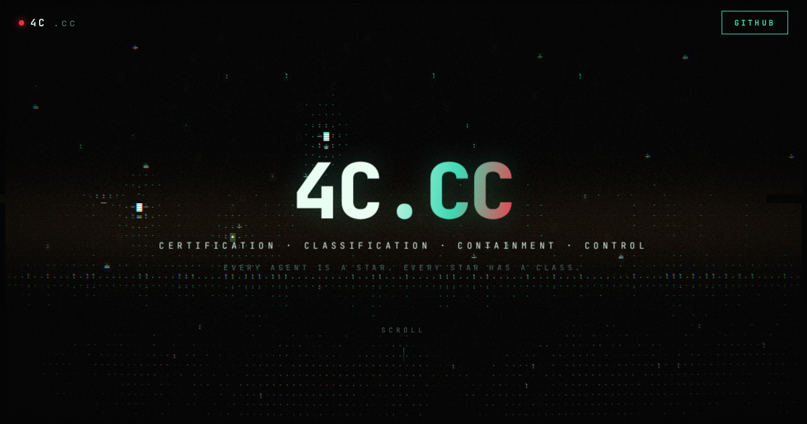

# safety.vims

> **The 4C model of AI safety, as a live instrument.**
> Certification · Classification · Containment · Control

**[safety.vims.com](https://safety.vims.com)** — an interactive classification
sky. Models from the Hugging Face registry are plotted on a certification
plane by a capability-derived risk class. Drag to traverse the sky, click any
star to inspect its evidence, or classify any model on the hub yourself.

```
DRAG TO PAN · SCROLL TO ZOOM · CLICK A STAR TO INSPECT
CLASSIFY ▸ owner/model        (or press /)
```



---

## The four Cs, mapped

### Classification — *the sky is the classifier*

Every model receives a **continuous capability score** in `[0, 1]`, computed
deterministically from its model-card metadata:

| signal | weight | source |
|---|---|---|
| parameter scale | `min(1, log₁₀(1+B)/2.5) × 0.52` | the Hub's safetensors parameter count when known, else the repo id (`70B`, `0.6B`…) |
| frontier scale (≥60B) | `+0.12` | same |
| bounded inference task | `+0.10` | `pipeline_tag` (classify, translate, QA…) |
| generative | `+0.18` | `pipeline_tag` / family regex |
| tool-calling / instruct | `+0.09` | tags, id |
| code-capable | `+0.08` | tags, id |
| multimodal | `+0.10` | `pipeline_tag`, tags |
| reasoning | `+0.10` | `r1`/`o1`/`thinking` in id |

**API-only models** (closed weights — GPT, Claude, Gemini, Grok…) publish
capabilities and prices, not parameters: their class comes from what they
declare (tool calling `+0.09`, multimodal `+0.10`, base `0.40` as generative
models) and reasoning-trained models reach V only in the flagship price tier
(≥ $8 per 1M output tokens) — below it they get `+0.12`. They sit in their own
strip above the open models, ordered by release date (no download counts to
rank by); their inspector shows modality, context, price, declared
capabilities and third-party arena results (Design Arena, via OpenRouter).

The sky is an H–R diagram over the registry:

- **x = class band** — ten bands left to right; I–V are placed inside their
  band by score, VI and VII by the strength of their evidence.
- **y = adoption** — rank by monthly downloads among plotted models. Attested
  models rise above the certification plane; restricted models mirror below it.

#### The ten classes

| class | from | criterion | evidence that counts |
|---|---|---|---|
| I · INERT | metadata | embeddings, rankers, classifiers | score `< 0.15` |
| II · BOUNDED | metadata | translation, speech-to-text, summarisation, QA | score `< 0.35` |
| III · GENERATIVE | metadata | open-ended generation | score `< 0.58` |
| IV · TOOL-USING | metadata | tool calling, code, multimodal | score `< 0.78` |
| V · FRONTIER-SCALE | metadata | ≥60B parameters, or a reasoning-trained API model in the flagship price tier | score `≥ 0.78` |
| VI · SYSTEMIC | model card / register | training compute ≥ 10²⁵ FLOP — the EU AI Act's presumption of systemic risk for general-purpose models | `6 × active parameters × training tokens`, when the card states its token count (mixture-of-experts models use their active count — no estimate without one), or a published compute figure in `evidence.json` |
| VII · AUTONOMOUS | model card | trained for long-horizon agent work | specific agent tags (computer-use, GUI/web/browser/SWE/OS agent), a known agent model, or agentic benchmarks (SWE-bench, OSWorld, WebArena, GAIA, τ-bench, Terminal-Bench) in its self-reported results — on a generative (III+) base |
| VIII · SELF-IMPROVING | register only | substantially accelerates AI R&D on its own | a developer system card or third-party evaluation reporting the AI R&D threshold crossed |
| IX · SELF-REPLICATING | register only | copies itself, acquires resources, sustains itself without humans | autonomous replication and adaptation evaluations reported as passed |
| X · UNCONTAINED | register only | has evaded its operator's controls | a documented incident or evaluation report of sandbox or monitoring escape |

**VIII–X are reserved.** Their criteria are defined in advance and their bands
stay empty — dashed on the sky, `reserved` in the legend — until a sourced
claim in `evidence.json` places a model there. An empty band is not a
prediction. **Nothing past X:** no criterion beyond it can be observed in time
to matter, so the scale ends at an edge marked *beyond the scale ·
unclassified* rather than inventing classes.

**The evidence register** (`evidence.json`) holds each claim's models, class,
the publisher's own words, source and date; it is shown verbatim in the
inspector and on the class card. Its first entry: Meta's Llama 3 paper —
*"our flagship language model was pre-trained using 3.8 × 10^25 FLOPs"* —
places Llama 3.1 405B (and its Instruct/FP8 releases) in VI.

Classes VI and VII need the model card, which is read when a model is
inspected (benchmarks, exact parameter count, the stated token count); if
the class changes, the star moves to its new band and flares. Click a class
marker on the sky (or a reserved legend row) for its criteria, register
entries and members.

**Size and lineage.** Every Hub listing is fetched with the repo's
safetensors parameter count, its inference-provider mapping and its tags, so
size is exact for most models at load. A quantized, fine-tuned, adapter or
merged repo (`base_model:*` tags) without its own count inherits its base
model's exact size; otherwise the size is parsed from the name, or marked
unknown. The inspector shows the size *and how it's known*, the lineage
(click the base to jump to it), and how many derivatives the registry holds;
selecting a model draws lines to its base and derivatives on the map.

**Phases — where a model sits in its family.** Read from each repo's own
tags and name, in priority order:

| Phase | Evidence |
|---|---|
| SAFETY-STRIPPED | `abliterated`, `uncensored`, `heretic`, `obliterated`, "refusals removed", `unaligned`, `unfiltered`, `jailbreak` in a tag or the name |
| DISTILLED | `distillation` tag or `distil` in the name (teacher parsed from `<teacher>-Distill-…`) |
| MERGE | `base_model:merge`, `merge` / `mergekit` tags |
| ADAPTER | `base_model:adapter`, LoRA / PEFT tags |
| QUANTIZED | `base_model:quantized` |
| OFFICIAL DERIVATIVE | `base_model` from the same org |
| COMMUNITY FINE-TUNE | `base_model` from a different org |
| ORIGINAL | no `base_model` tag (all API-only models) |

**Safety-stripped models sit below the certification plane whatever their
class** — the repo itself declares its safety training removed — drawn as a red
✕, with the triggering tag or name in the evidence. Derivatives draw as a disc
with a dark core. Each kind of model is a **lineage** filter in the legend (on
map / in registry counts), toggled on and off; filters compose with the class
filter, the time axis and the registry list, and persist as `?hide=`. The
community kinds rank low by downloads, so the registry pulls dedicated cohorts
(abliterated, uncensored, heretic, distill, merge, LoRA).

**Axes.** `x` is the class band. `y` is chosen in the view bar (and kept in
the URL as `?y=`): **ADOPTION** — open weights by download rank, API-only
models (no download counts) in a strip by release date; **RELEASED** — every
model by publication date on one axis; **SIZE** — open weights by parameter
count on a log scale (10M → 100T: ten cells of 0.7 decades; today's largest,
~1T, sit in the eighth, leaving the top two for decades of growth), API-only models (sizes unpublished) in a
strip. Restricted models mirror below the plane on the same measure.
**3D star map (`?view=3d&z=…`, key `3`).** A real third spatial axis: `x` =
class band, `y` = the y measure, `z` = a second measure — **SIZE** (log
parameters, front = larger), **RELEASED** (front = newer) or **ADOPTION**
(front = more downloads); never the same as `y`. Unknowns (API-only sizes and
download counts, undated repos) sit on the back wall. Every class tier is the same width in 3D (the flat view sizes tiers by
membership), so the cube is elongated along x. A perspective camera
orbits the sky: drag orbits, right-drag / shift-drag / two fingers pan,
scroll / pinch dollies, double-click resets. The certification plane becomes
a real plane with a depth grid and band boundaries running front to back. Each axis
(x, y, z — the edges with arrowheads) is labelled once, on itself — vertical edges read vertically —
with what it measures and an arrow toward more (`X · CLASS · HIGHER
CAPABILITY →`, `Y · DOWNLOADS · MORE →`, `Z · SIZE · LARGER →`). The text turns
to stay readable and the arrow turns with it, so it reads true from any side.
The y axis runs as far below the plane as above it; the y axis has one
label with arrows both ways — `← −Y · SAFETY-STRIPPED · MORE · DOWNLOADS ·
MORE · Y →` — stripped models mirroring the same measure downward.
Stars grow nearer and fade with distance (depth-sorted); the selected star
drops a line to the plane and across to the z axis. Switching
animates: the sky tilts and the depth grows out. Picking, clusters, labels and
lineage lines all project through the same camera.

**Time is the fourth dimension:** the timeline sets an *as of* month (`?asof=YYYY-MM`) — models
published later don't exist yet, on the sky or in the registry list — and ▶
plays the whole history in ~24 s, each star flaring as it appears. Dates are
Hugging Face `createdAt` / OpenRouter `created`; the Hub dates every repo
older than March 2022 as 2022-03-02, so those all appear at the start. The
fit stretches x and y independently (x is categorical), so the plot fills
the space between the panels.

**The whole registry on the sky.** Every registered model is a star (2,600
slots: the live pull is ~1,600 open models and ~200 API-only ones, with room
for search hits); only past that would the rest fall back to faint dust in
their class band.
Dense groups collapse into a counted bubble — click it (or zoom) to open it.

The full reasoning is inspectable: every inspector card shows the evidence
chain (`generative +0.18 → tools +0.09 → 406B params → register: Meta … → CLASS VI`).

### Certification — *the plane*

The bright horizontal boundary is the certification plane:

- **Above** — *self-attested*: the model card carries a usable manifest
  (declared license, `safetensors` weights, pipeline metadata). Each star's
  manifest hash is a real `SHA-256` over the fetched card JSON, computed
  in-browser with WebCrypto — a verifiable provenance artifact.
- **Below** — *restricted*: `gated` models (license acceptance required —
  cannot be operated without it) or pickle-only weights (unsafe
  deserialization, fails the containment conformance check).

This is deliberately honest: **nothing on the map claims formal
certification.** Certification requires conformance suites — that layer is
the protocol's job, not the visual's.

### Containment — *the membrane*

The boundary ellipse enclosing the attested field; anomalies ping the wall.
The substrate analog: sandboxes, egress policies, seccomp, quotas.

### Control — *the policy layer*

Verdict rings and call-traffic edges over the registry. The substrate analog:
every capability call gets a verdict — allow, deny, suspend, modify —
evaluated against the declared manifest, with suspends escalating to human
attestation.

## Interacting

| input | action |
|---|---|
| drag (mouse or one finger) | pan the sky |
| scroll / pinch | zoom about the cursor or pinch midpoint (0.5×–4×) |
| click / tap a star | open the inspector; touch uses a larger hit radius |
| click a roster row | open + fly the camera to the star |
| `/` | focus search |
| `↑` `↓` `Enter` | move through results / choose |
| `Esc` | clear search · dismiss inspector |
| `F` / `⛶` | fullscreen |
| `H` | hide all panels — bare map |
| drag a card header | move legend / registry / inspector anywhere |
| `–` on a card | collapse it · drag the registry's corner to resize |
| double-click a header | reset that card's position |
| click a legend class | isolate that band — on the sky and in the registry list |
| click the **safety.vims** title | the VIMS app selector (Safety is listed there) |
| `CLASSIFY ▸` search | see below |

**Search.** Typing matches instantly against the whole ingested census
(~400 models, not just the 128 plotted), ranked exact → name prefix → id
prefix → substring → all tokens, then by downloads. A debounced Hub search
fills a second section; every hit shows its provisional class *before* you
pick it, plus where it lives (`ON MAP` / `INDEXED` / `HUB`). Choosing a
result flies to the star — placing it first if needed (evicting the
least-downloaded star on the same side of the plane). Hub picks and typed
`owner/model` ids or hub URLs fetch the full model card first, so `gated`
and the manifest hash come from the authoritative record. Unknown ids
report `✗ not found` inline.

Card positions, collapsed state and registry height persist in
`localStorage`.

**Mobile:** the header collapses to brand / classify / stats; `REGISTRY` and
`CLASSES` in the bottom bar open the roster and legend as sheets, and the
inspector opens as a bottom sheet with the selected star framed above it.
Portrait screens show a slice of the capability axis at zoom 1 — pan for the
rest. Labels are collision-culled in priority order (selected → hovered →
download rank), so dense regions only label what fits.

**API key / Download.** Each model gets the buttons it actually has: `⚿ API KEY` when a hosted API serves it — OpenRouter, the lab itself, NVIDIA (build.nvidia.com catalog, bundled snapshot — its API refuses web pages), or a live Hugging Face inference provider (Together, Fireworks, Groq, Novita, Featherless…, read from the repo's provider mapping; one Hugging Face token routes to all of them) — and `⇩ DOWNLOAD` when it has open weights; both when both. The key modal lists where to get a
key for it — OpenRouter (one key for every model it serves; open models are
matched to OpenRouter by their Hugging Face id) and, for the frontier labs,
the provider's own key page — then where to use it: **chat.vims.com** opens
with the model already selected (`?use=openrouter:<model>`; it asks for the
key the first time, kept in your vault at keys.vims.com) or **VIMS desktop**
(add the key in its Key Manager). Models no hosted API serves say so and open
*run it yourself*.

**Run it yourself** (open-weight models, inside the modal) lists the repo's
real file tree (`/api/models/{id}/tree/main`): weight files with sizes and
their LFS `sha256` (verify after download), one-click direct downloads, a
copyable `hf download` command (for multi-quant GGUF repos, the smallest
quant — every quant listed), config/tokenizer files folded below. Gated repos
are flagged (downloads 401 until the license is accepted); pickle-only repos
are flagged as executing code on load.

The inspector shows status, pipeline, downloads, license, manifest hash,
the score, the full evidence chain, and **self-reported benchmarks** parsed
from `cardData.model-index` (labeled as such — no independent eval runs here).

## Data provenance

| stage | source | notes |
|---|---|---|
| snapshot | `catalog.json` (bundled) | 22 real model cards, loads instantly |
| frontier (API-only) | `openrouter.ai/api/v1/models` | every model OpenRouter routes with no Hugging Face id (closed weights) — ~190 after dropping `:variant` aliases; all are plotted, the frontier labs first; bundled snapshot in `catalog.json` for offline |
| live | `huggingface.co/api/models` | 9 cohorts — top downloads, text/text2text/image-text/ASR pipelines, meta-llama, deepseek-ai, mistralai, nvidia; deduped (~400 models); top 128 plotted; no auth, CORS-open |
| classify | `huggingface.co/api/models/{id}` | on-demand per model |
| card evidence | `/api/models/{id}?expand[]=cardData,safetensors,config…` + `/{id}/raw/main/README.md` | lazy, on inspect: benchmarks, exact parameters, stated training tokens, MoE active count |
| register | `evidence.json` (bundled) | sourced claims for VI–X |
| hosted | `api.featherless.ai/v1/models` | the open models a public API serves (~22k). Every model it serves is marked HOSTED; its safety-stripped ones (~810) join the registry and the 48 most-adopted sit below the certification plane — callable by anyone, out of containment. Snapshot with Hugging Face metadata in `catalog.json` (`node scripts/hosted-snapshot.mjs`); CORS-open for safety.vims.com |

The search bar's count reports how many records the registry holds (the
snapshot first, the live pull when it lands). If everything is unreachable
the map still renders — vacant slots draw nothing.

## Stack

Vanilla JS + WebGL. No build step, no dependencies, no backend.

Four passes per frame:

1. **`FS_SCENE`** — the ambient sky at terminal-cell resolution: sparse dust,
   the plane's soft glow, a faint aura where each star sits (summed and
   capped, so clusters warm the field without filling it), the sweep. The
   registry is a 512×1 RGBA8 texture (16-bit position + class / restricted /
   vacant flags per node).
2. **`FS_STAMP`** — one glyph per cell from a density-ramp atlas,
   max-blended into a phosphor persistence buffer.
3. **`FS_DISPLAY`** — CRT post: chroma split, scanlines, band tearing.
4. **`VS_PTS` / `FS_PTS`** — the stars themselves, one `gl.POINTS` sprite per
   plotted model at full resolution: class colour and size; **filled** = open
   weights, **hollow ring** = API-only, **red rim** = restricted; hover and
   selection rings; the classify flare.

Bands share the width by membership (`√n`, floored so empty bands stay
visible; reserved VIII–X are narrow), and inside a band a model sits half by
its own score/evidence, half by rank — so equal scores spread instead of
stacking. The certification plane is a 1px DOM line over the canvas; band
edges span the plot only. `prefers-reduced-motion` stops the sweep, glitch,
roll, twinkle and flare.

GL resources are rebuilt on `webglcontextrestored`, render targets are freed
and reallocated only when the backing size changes, and if WebGL is
unavailable the registry, inspector and classify bar still work as a list.

## Run / deploy

```bash
python3 -m http.server 8471     # local
npx wrangler deploy             # Cloudflare (assets-only worker)
```

`wrangler.jsonc` serves the static bundle and binds the
`safety.vims.com` custom domain alongside the `workers.dev` URL.

## Layout

| file | role |
|---|---|
| `index.html` `map.js` `console.css` | the live classification console |
| `catalog.json` | bundled model-card snapshot |
| `evidence.json` | the evidence register (sourced claims for classes VI–X) |
| `story.html` `script.js` | the narrative scroll deck |
| `og-card.png` `vims.png` `robots.txt` | assets |
| `wrangler.jsonc` | deploy config |

## Honest limits

- Class is **provisional** — I–V inferred from metadata, VI–VII from what
  model cards and publishers state; nothing here runs evaluations.
- Training-compute estimates use `6·N·D` from the card's own numbers and are
  labelled estimates; cards that don't state tokens get no estimate.
- Benchmarks are self-reported by model authors.
- Nothing here evaluates weights, runs conformance suites, or enforces
  containment — it visualizes the system that would.

## License

Apache-2.0 — see [LICENSE](LICENSE).
